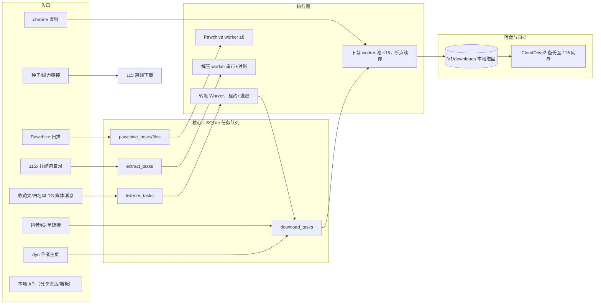
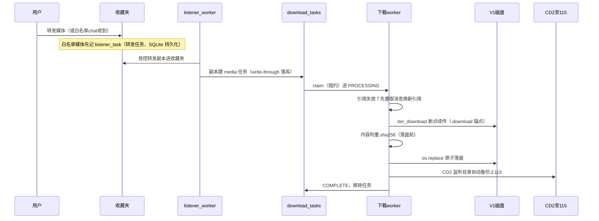
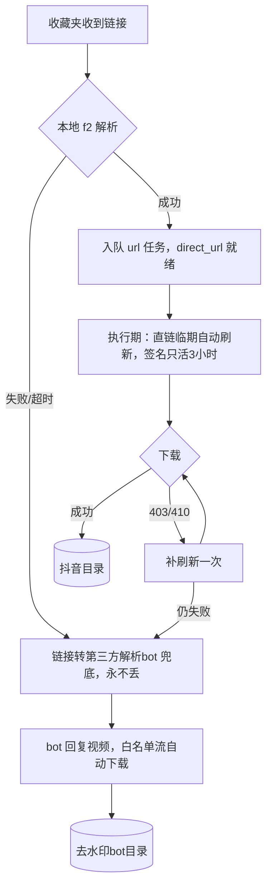
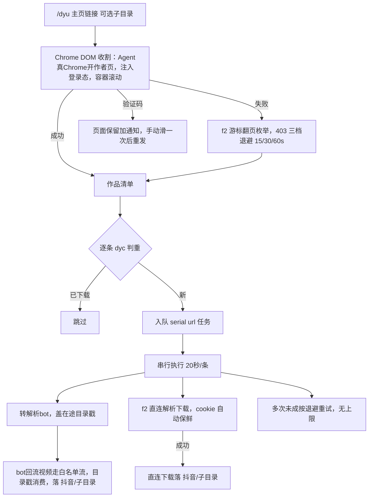
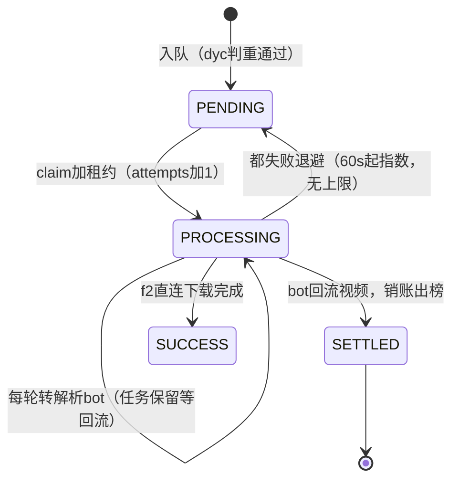
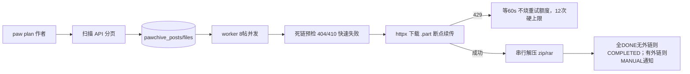
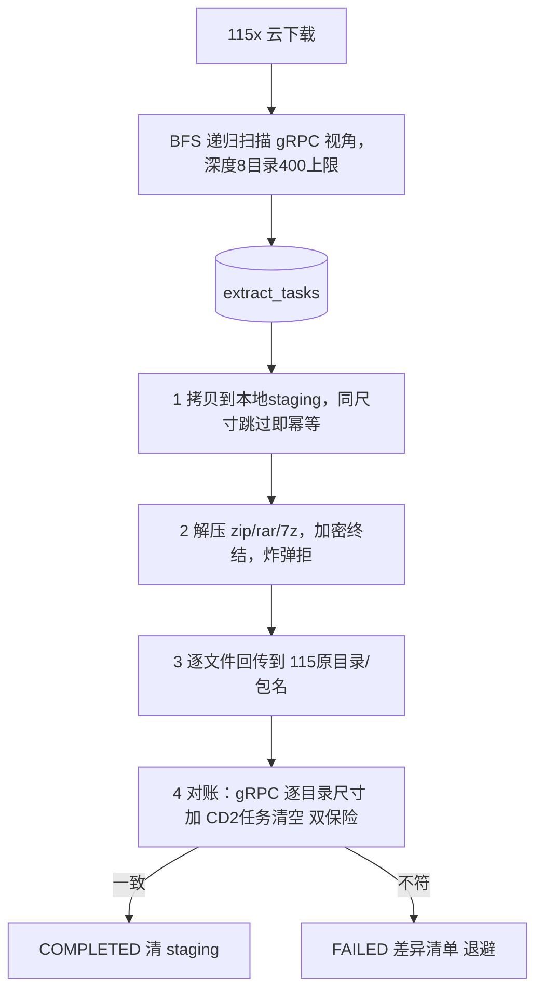
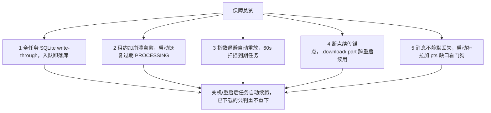
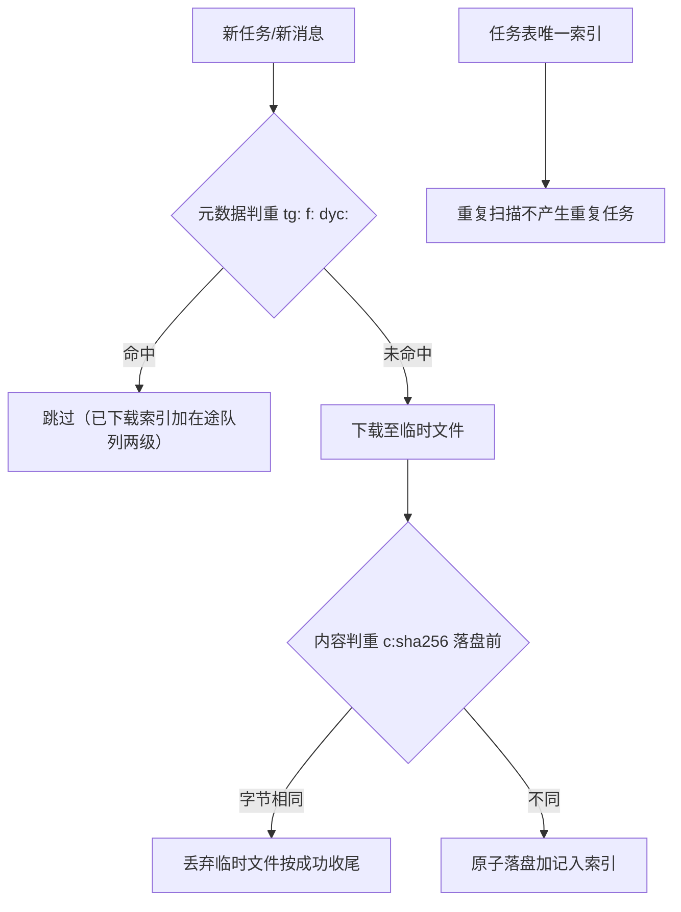

# tg_userbot 下载链路操作指引

> **版本**：v2.30（2026-11-08）｜ 适用 bot v2.10 + Runtime DB schema v22
> **获取本文档**：收藏夹发送 `/manual`，bot 会把本文件发给你
> **维护纪律**：任何下载链路的命令/机制/参数变更，**必须同步更新本文档并递增版本号**（见文末更新记录）

---

## 1. 总览：七条下载链路



| # | 链路 | 入口 | 命令 | 执行特征 |
|---|------|------|------|---------|
| 1 | TG 媒体（收藏夹+白名单+标签监听） | 转发/发送媒体 | 无（全自动）；`/queue` `/progress` 看 | worker 池 ≤15 并发，断点续传 |
| 2 | 抖音/IG 单链接 | 收藏夹发链接 | 无（全自动） | 本地 f2 解析优先，第三方 bot 兜底 |
| 3 | 抖音作者批量 | 主页链接 | `/dyu <链接> [子目录]` | **串行**，20s/条节流，解析 bot 优先 |
| 4 | Pawchive | 作者名 | `/paw plan <作者>` | ≤8 帖并发，死链预检，429 感知退避 |
| 5 | Chrome 直链 | URL | `/chrome [子目录/]URL` | Chrome Agent 浏览器下载 |
| 6 | 115 解压回传 | 115 目录 | `/115x <路径>` | 串行一次一包，回传+对账 |
| 7 | 种子/磁力 → 115 离线 | .torrent 链接/文件 | 无（全自动） | CD2 离线拉取，完成守望通知 |

---

## 2. 链路一：TG 媒体（主力链路）

### 2.1 数据流



### 2.2 关键机制

- **断点续传**：`.download` 半成品是**续传锚点**，重试/重投/重启都从断点继续；代理掐流只损失尾部。有字节推进时重试上限 3→15 次；零推进维持 3 次快速止损。
- **引用自愈**：`LocationInvalidError`/`FILE_REFERENCE_EXPIRED` 先重取消息换新引用再重试（连续 2 轮零字节或断点处连续 3 轮停滞 → 判定**媒体服务器端失效/截断**，移出队列并通知，不再无限重投）。
- **看门狗**：120s 无进度判连接僵死，取消重试。
- **半成品清理**：启动清理只动 **7 天以上**的陈旧 `.download`（新鲜锚点绝不动）。

### 2.3 命令

| 命令 | 作用 |
|------|------|
| `/queue` | 队列与待重试列表 |
| `/retry` / `/retry_all` / `/retry_del` | 重放/清空/移除待重试 |
| `/queue_del N` | 移除队列任务 |
| `/progress` | 进行中下载实时进度（含来源链接） |
| `/done` | 最近完成清单 |
| `/find <关键词>` | 按标题查一条媒体的下落 |
| `/thread N` | 调并发（1-15，每条占一条独立连接） |

---

## 3. 链路二：抖音/Instagram 单链接



- **双保险降级**：本地解析失败自动转 `@DouYintg_bot`（它在自己服务端解析，不受本地风控影响），回复的视频经白名单流自动下载——**最坏情况 = 维持日常可用**。
- **HTML 守卫**：下载流拿到 `text/html` 一律判失败重试，**绝不落盘假文件**。
- cookie 更新：`/cookie`（或 bot 菜单 ✏️ 更新）。

---

## 4. 链路三：抖音作者批量 `/dyu`

### 4.1 全流程



### 4.2 状态流转（每条作品的任务）



### 4.3 命令与注意

| 命令 | 作用 |
|------|------|
| `/dyu <链接> [子目录]` | 发起批量（子目录省略用作者昵称） |
| `/dyu <链接> since YYYY-MM-DD [子目录]` | **只要该日期之后的作品**（f2 枚举+整页早停；v1.1） |
| `/dyu <链接> all [子目录]` | **连转发的也收**（默认仅原创；v1.2） |
| `/dyu` | **进度面板**（待下载/下载中/待重试/最近完成） |

- **默认仅原创**（v1.2）：作品列表里的转发内容自动跳过（判据=作品
  author.sec_uid 是否为作者本人，实测可靠）。要连转发一起收加 `all`。
  原创/起止日期过滤都走 f2 枚举（Chrome 页面读不到这些字段）。
- **节流 20s/条**是硬约束（保护第三方 bot），87 条全量约 30 分钟转交完。
- **在途目录戳**：转交瞬间盖章，bot 回流的下一个视频落 `抖音/<子目录>/`（一次性消费，180s TTL）。偶发错位（bot 乱序回复）会把某条落进默认目录，手动移动即可。
- 触发**验证码**：bot 会把验证页留在 Chrome 窗口并通知，手动滑一次、重发命令。
- ~~msToken 保鲜~~ 已退役（v1.4）：新版抖音不再落持久 cookie，枚举主路为 Chrome 钩子收割，不依赖 msToken。

---

## 5. 链路四：Pawchive（`/paw`）



- 常用：`/paw`（状态）/ `/paw plan <作者>` / `/paw retry <id|all>`（死链不重投）/ `/paw manual`（外链清单）/ `/paw pause|resume` / `/paw csv <作者>`。
- **外链白名单**（v1.3）：帖子里的站外链接只有命中常用网盘（MEGA/
  Google Drive/百度/夸克/阿里云盘/蓝奏云/PixelDrain/GoFile 等）才记录并
  可能进人工清单；社媒/个人站等噪声链接直接丢弃——仅含噪声链接的帖子
  整体不入队。白名单在 `config.PAWCHIVE_EXT_LINK_HOSTS`，可扩。
- 缩略图追回：`/paw recoverthumbs on`（死链补低清缩略图）。
- 磁盘保护线 2GB：低于暂停 worker，`/paw resume` 恢复。

---

## 6. 链路五~七：Chrome 直链 / 115 解压回传 / 种子离线

### 6.1 `/chrome [子目录/][#标注] URL`
网盘页等浏览器才能下的直链交给 Chrome Agent（独立实例可后台）。`/chrome_tasks` 看任务（每条带 🛑 取消），`/chrome_start|stop|status` 管 Agent。

### 6.2 `/115x <115路径>`（递归含子目录）

- 回传目标 `<原目录>/<压缩包名>/` 天然防同名、防套娃。
- `.zip` 结尾的**目录**是 115 云解压残留（不是压缩包），扫描会提示跳过。
- `/115x` 裸命令看状态；`stop/start/retry id/del id`。
- `/115x watch <路径>`：**登记目录每小时自动扫新包入队**（v1.6，唯一键判重只收新的；`/115x watch` 看列表，`unwatch <路径>` 取消；登记持久化跨重启）。
- **加密压缩包**（v1.7）：需密码时自动用**压缩包所在最后一层目录名**做密码尝试一次（如 `/云下载/Telegram@XXX` 下的包用 `Telegram@XXX`）；仍失败则跳过（PASSWORD 状态，不占队列），下次扫描该目录时自动重置再试。支持 ZipCrypto/AES（libarchive）。
- 依赖：CD2 运行中 + 挂载 `/Volumes/CloudDrive` 在线。

### 6.3 种子/磁力（全自动）
收藏夹或 bot 对话发 `.torrent` 链接/文件 → 解析 infohash → 115 离线 → **完成守望**轮询目录，新文件出现即通知（默认守望 30 分钟）。`/cd2tasks` 看离线/上传任务。

---

## 7. 数据不丢：五层保障



| 场景 | 行为 |
|------|------|
| 下载中关机 | 半成品留锚点，重启续传（不重下已完成字节） |
| 消息在停机窗口发来 | 启动 catch_up 补拉（日志「📬 启动补拉完成」） |
| 连接活着但更新流卡死 | pts 看门狗检测缺口 → 补拉 → 两次无效断开重连 |
| worker 崩溃 | 租约到期自动回 PENDING 重跑 |
| DB 暂时写失败 | 任务不推进状态，下轮重来（绝不假成功） |
| CD2 备份 | **搬移语义**：上传 115 后删本地源（本地是暂存区，115 是归档） |

## 8. 数据不重：判重体系



- 原则：**不确定就放行**（判重永不误拦，宁可重复下载一条也不丢）。
- `/dedup on|off` 可临时关闭（关闭后同内容会重复落盘，慎用）。
- 终结性任务（媒体失效/死链/需密码）**移出队列不再重投**，避免无限空转；`/paw retry` 与 `/dyu retry` 可人工重投。

## 9. 日常运维

| 命令 | 用途 |
|------|------|
| `/inspect` | 系统巡检（连接/任务/产出/失败/备份） |
| `/status` / `/progress` / `/done` | 状态/进行中/完成 |
| `/stats` | 台账汇总（今日成功/失败/去重拦截） |
| `/cd2check` / `/cd2tasks` | 115 备份 API 实对账 / CD2 任务明细 |
| `/restart` | 优雅重启（保存状态，约 30s） |
| `/manual` | **获取本文档** |
| `./run.sh start|stop|restart|status` | 服务器侧进程管理 |

### 注意事项（踩过的坑）

1. **代理是命门**：TG 全部流量走 `tg_proxy`（Hiddify）；代理劣化表现为下载反复断流、`IncompleteReadError`——换节点即可，链路自愈。
2. **抖音风控三件套**：403（msToken 过期，等冷却或刷新 Chrome）、验证码（Chrome 窗口手动滑）、游客墙（Chrome 收割自动注入登录态）。
3. **CD2 必须在跑**：`/115x`、备份、对账都依赖；掉线时相关任务退避等待，不丢。
   ⚠️ **FUSE 挂载会单独死**（2026-10-19 实测）：CD2 进程活着、gRPC 正常，但
   挂载整体 `Device not configured`——表现为 /115x 全部「挂载视图抖动」。
   处置：重启 CD2（自动重新挂载）即可恢复；重启后 TERMINAL 的任务重投即成
   （gRPC 视角文件一直在，死的只是挂载视图）。
4. **`/dyu` 大作者耗时长**：串行+20s 节流是刻意设计（保护第三方 bot），别并行。
5. **判重键清理要谨慎**：`dyc:`/`c:` 键删除后可能重复下载；只在确知污染时清。
6. **敏感信息**：cookie/token 只存 `tg_secrets.json`（gitignore），绝不入代码/日志。

## 10. 数据表速查（schema v12）

| 表 | 内容 |
|----|------|
| `download_tasks` | 队列（media/url 任务，含 /dyu 批量） |
| `listener_tasks` / `listener_checkpoints` | 标签监听/白名单转发任务与游标（同事务） |
| `pawchive_posts` / `pawchive_files` | Pawchive 帖子与文件状态机 |
| `extract_tasks` | /115x 解压回传 |
| `dedup_index` | 判重索引（tg:/f:/dyc:/c:） |
| `download_history` / `download_events` / `task_events` | 历史/事件台账（/done /stats /find 数据源） |

`/sql` 与 `/sqlt` 可自由查询这些表。

---

## 11. 本地 API 入队（套壳 app / 手机看板，2026-11-01）

userbot 进程内的只读+薄写入 HTTP 服务（aiohttp，随主进程启停）。**与 bot 菜单读写同一套状态**——看板看到的队列/台账与 `/queue`、`/stats` 同源，不建第二套状态。

**开启**（`tg_secrets.json` 的 `api` 段，重启生效）：

```json
"api": {"enabled": true, "bind": "127.0.0.1", "port": 8765, "token": "随机长串"}
```

- `bind=127.0.0.1` 且 token 留空 = 仅本机免鉴权；**非 loopback 必须配 token，否则拒绝启动**。手机访问：同 WiFi 绑局域网地址，外网推荐 Tailscale（两端装，app 填 Tailscale IP）。
- 鉴权三通道任选：`Authorization: Bearer <token>` / `X-Token` 头 / `?token=` 查询参数。

**端点**：

| 端点 | 说明 |
|---|---|
| `GET /` | 看板页面（总览/队列/入队/历史，2s 轮询） |
| `GET /api/status` | 总览快照：在途/排队/待重试/今日台账（rebuild 口径）+ 在途进度 + 磁盘余量 |
| `POST /api/enqueue` `{"text": "…"}` | **与往收藏夹发这条消息同语义**：抖音/IG → 本地解析入队（失败转解析 bot）→ 种子 → 115 离线 → B站 → 外链台账；分享文本里的非链接部分自动当备注 |
| `POST /api/action/<name>` | 白名单动作：`clean` / `wl_scan` / `listen_scan` / `retry_all`（对应 `/clean`、`/wl scan`、`/listen scan`、`/retry all`） |
| `GET /api/history?n=20` | 最近完成（/done 同源，n≤200） |
| `GET /api/stats?days=1\|3\|7` | 台账文本（/stats 同源渲染） |
| `GET /api/find?q=关键字` | 媒体下落三源查询（/find 同源，≥2 字符） |
| `GET /api/chrome` | Chrome Agent 视图（状态+任务列表，bot 菜单 🌐 同源） |
| `GET /api/paw_backfill` | **回填执行情况三段式**（v2.12）：当前状态（游标/节奏/循环起点）+ 下一批作者（预计时间）+ 每轮执行记录（pawb_history.jsonl，保 200 条；backfill_loop 每轮结束自动追加） |
| `GET /api/backup` | **CD2→115 实时备份视图**（在途上传任务+进度+全部任务计数，gRPC 30s 硬顶；CD2 未运行返回友好提示） |
| `POST /api/cmd {"cmd": "/extract <子目录> [dry]"}` | **目录解压**（v2.10）：递归解压下载目录内子目录的压缩包到同名文件夹（成功才删；Telegram 后台执行 + 完成通知；dry=预览） |
| `GET /api/pastes` | **粘贴历史**（新→旧，含逐条当前处理状态——下载任务查事件流、iwara/Chrome 查任务表、台账查 runtime DB；JSONL `paste_log.jsonl` 存 500 条） |
| `GET /api/links` / `POST /api/links_done {"id":…}` | **人工待处理外链台账**（/links 同源 runtime DB：PENDING 清单 + 一键 ✅ 标记完成，幂等） |
| `GET /api/chrome`（v2.5 起） | 响应新增 `progress` 字段：**Chrome 下载实时进度**（received/total/speed/filename，来自 chrome_progress.json——Agent 独占写、节流 1s、尝试结束即清；>90s 未更新视为过期不展示） |
| `POST /api/action/…`（v2 扩充） | 开关：`dedup_on/off`、`listen_on/off`、`thread {"n":1-25}`；Chrome：`chrome_start/stop/cancel {"id":…}`；Pawchive：`paw_pause/resume/status`；B站：`bili_status`；CD2：`cd2_start/stop`；巡检：`health`、`now` |

**指令中心（v2.3）**：`GET /api/commands` 返回分组指令注册表（BOT_COMMANDS 同源，
按组归类）；`POST /api/cmd {"cmd": "…"}` 以无头事件执行白名单内指令——
**非 / 开头的输入按链接/分享文本分流**（iwara → Chrome 下载、B站/抖音/种子/外链
同 enqueue 语义）；iwara 链接直达：判重（成功过不重复）→ 提交 Chrome Agent
（CDP 签名直链）——与 bot 对话同语义（v2.6 补齐，此前掉进外链台账）；
看板总览实时进度含 Chrome 下载进度条（/api/status 的 chrome_progress 字段）。
（回复文本原样返回，90s 上限）。**排除项**：/sh（任意命令）、/sql、/sqlt、
/restart（会杀 API 本体）、/up（本机文件）、/paw_cookie（输入窗口流程）。
看板「⌨ 指令」页 = 分组面板（点指令填入输入框）+ 万能输入框；结果统一弹卡
（成功/失败 + 完整输出，长文本等宽滚动）。结果弹卡已按反馈放大
（宽 min(94vw,660px)、正文 60vh 滚动）。

**Runtime DB 迁移（v2.8，根治整站冻结）**：runtime DB 从外置卷
`/Volumes/V1/runtime/` 迁到内置盘 `~/tg_downloader/tg_userbot.db`
（run.sh 默认 `export TG_RUNTIME_DB="$HOME/tg_downloader/tg_userbot.db"`，
可用环境变量覆盖）。原因：外置卷被 CD2 大量上传占满 I/O 时，同卷 SQLite
查询会阻塞事件循环数分钟——API/看板/Telegram 处理全部冻结（实测）。
媒体与下载目录仍在 V1（CD2 的职责不变）。旧卷 DB 文件保留未删。

**代理绕过（v2.9，关键）**：ts.net 的 Funnel 入站要从境外回连家里宽带 443——
凡「出境再回连」的路径（浏览器走 Hiddify 系统代理）会被 GFW 间歇掐断
（实测走代理 3×000 超时、直连 200/0.2s）。修复：Wi-Fi 服务代理绕过列表加
`*.tailb6d3d9.ts.net`（networksetup 已配）→ 浏览器/app 直连 tailnet 环回稳定。
注意 Hiddify 重连可能重置系统代理——届时在 Hiddify 路由规则里加
「域名后缀 tailb6d3d9.ts.net → 直连」。

**PWA（v2.11，手机端免 APK 终态）**：看板即 PWA——manifest + SW + 图标 +
share_target（/share 分享接收页）。手机浏览器打开 ts.net → 「添加到主屏幕」
→ 桌面图标点开即全屏看板；**系统分享面板可直接选它接收链接**（等价于壳
app 的分享直达，走 /api/enqueue 同一分流）。壳 app（prototype/NagramShell）
的独有价值只剩离线补投，可退役。SW 只缓存静态壳（/api/* 永远网络优先）；
manifest/sw/图标/share 页免鉴权可取（安装与分享面板不带令牌）。

**访问面（2026-11-01 收紧后）**：API 只绑 `127.0.0.1`——局域网/Tailscale 网卡均不可达，
唯一公网入口 = Funnel 的 `https://<节点>.ts.net`（TLS + token）；**非 loopback 来源
限流 120 次/分钟**（429），本机豁免。

**Telegram 中转通道（v2.1，解决"安卓单 VPN"限制）**：手机上 Tailscale 与代理
（Hiddify 等 VPN 模式）互斥，套壳 app 的分享改为**持 bot token 经 Bot API**
以 bot 身份把「🛰 <原文>」发进 bot 对话；主账号在 `new_message_handler`
入口（classify 之前）识别 bot 发来的 🛰 消息 → `api_server.handle_app_relay`
→ 与 `/api/enqueue` 同一条 `dispatch_link_text` 链路 → 结果以「📲 分享直达」
通知回控制面板。app 端 fire-and-forget；标记 🛰 不在 CLEAN_NOTIFICATION_PREFIXES
（单测钉死，防 bot 通知被误当分享）。**手机零新增依赖**：Telegram 能通它就能通，
代理照常用，Tailscale 留在 Mac 侧即可。

**远程看板：Tailscale Funnel（2026-11-01）**：`tailscale funnel --bg 8765`
把 API 发布为 `https://<节点名>.<tailnet>.ts.net`（首次需在管理页一键授权，
链接由命令输出给出；TLS 证书自动签）。手机不装 VPN——浏览器直接开
`https://…ts.net/?token=<api token>` 即仪表盘，或把该域名填进 app
「服务器直连」。关闭：`tailscale funnel --https=443 off`。该地址公网可达，
仅靠 api.token 保护。

**套壳 app**（`prototype/NagramShell/`，Kotlin+Compose，<500 行）：WebView 载看板（地址+token 首次配置）+ 系统分享直达（分享面板「存到下载器」→ POST 入队）+ **离线补投**（后端不可达时分享内容暂存本机，可达后自动重投；服务端三级判重兜住重复）。通知不走 app——仍由 Telegram 控制面板承担。

---

## 更新记录

| 版本 | 日期 | 变更 |
|------|------|------|
| v1.0 | 2026-10-02 | 初版：七链路全图、五层不丢保障、判重体系、/dyu 三顺位策略与目录戳、断点续传与终结性判定 |
| v1.1 | 2026-10-03 | /dyu 新增 since 日期参数（f2 专属路径，整页早停）；无次数上限重试+bot 回流销账；/115x staging 移出 CD2 备份树 |
| v1.2 | 2026-10-03 | /dyu 默认仅原创（author.sec_uid 判据，转发自动跳过；all 收全部）；/115x 对账分页截断误报修复、21GB 巨包拷贝短读校验与解压超时按大小放大、挂载抖动假终结 gRPC 复核 |
| v1.3 | 2026-10-04 | /paw plan 外链白名单：仅常用网盘链接（MEGA/百度/夸克/阿里云盘等，config.PAWCHIVE_EXT_LINK_HOSTS）进人工处理，噪声链接丢弃、纯噪声帖不入队 |
| v1.4 | 2026-10-04 | Argus 风控应对：抖音 10-03 夜间升级后 f2/注入 cookie/CDP Network 域全被拒；枚举主路改「Agent Chrome 页面内 fetch 钩子收割」（导航前注入、零 CDP 网络域，字段全量支持原创/since），f2 降级回落 |
| v1.5 | 2026-10-09 | /dyu 重试策略定稿（每轮 bot 优先+销账出榜+委托不受 6h 熔断）；短读 EOF 按服务器实际收尾（元数据虚高不再死循环）；/botclean 劫持与 /cd2check 死命令修复+逐命令 dispatch 钉子；队列 sqlite 成功路径不再穿透 JSON 全量写；httpx 连接池泄漏修复；CD2 菜单补回「▶️ 启动」按钮 |
| v1.6 | 2026-10-09 | /115x watch：登记目录每小时自动扫描新压缩包入队（唯一键判重只收新的，登记持久化跨重启） |
| v1.7 | 2026-10-09 | /115x 加密压缩包：目录名做密码尝试一次（失败跳过、下次扫描重置再试，PASSWORD 状态不占队列）；bsdtar 统一密码解压路（ZipCrypto/AES） |
| v1.8 | 2026-10-14 | 收藏夹启动对账兜底：catch_up 对长停机大缺口不保证完整（10-10 实测离线 5 天的转发未到达）——直接拉收藏夹最近 100 条按 msg_id 水位线核对补入队，判重挡已下载 |
| v1.9 | 2026-10-26 | 新链路 /asmr（asmr-300/Kikoeru 音声）：`/asmr <作品页链接|RJ号> [only 关键词]` → API 文件树逐文件断点下载 → 115 `声音/asmr/RJ号/`（目录树原样还原）。API 域名可配（tg_secrets.json `asmr.api_base` 或 TG_ASMR_API）；API 走 TG_PROXY + zh 语言头；RJ 主键判重、幂等续跑、逐文件续租；schema v19 `asmr_tasks` |
| v2.0 | 2026-11-01 | 新入口：本地 API（aiohttp，`api` 段配置）——看板/`/api/status`、分享直达/`/api/enqueue`（与收藏夹发链接同语义，三级判重继承）、动作白名单/`/api/action`、`/api/history`；非 loopback 绑定强制 token。套壳 app（prototype/NagramShell）分享直达+离线补投 |
| v2.1 | 2026-11-01 | app 分享加 Telegram 中转通道：Bot API 以 bot 身份发 🛰 标记消息 → 主客户端 new_message_handler 抢先分支 → handle_app_relay（dispatch_link_text 同链路）→ 📲 通知回面板。绕开安卓单 VPN 限制（Tailscale×代理互斥），手机零新增依赖；api.bind 回 0.0.0.0（家里 WiFi 看板直连，token 鉴权） |
| v2.2 | 2026-11-01 | API v2：`/api/stats`、`/api/find`、`/api/chrome` 文本视图；动作白名单扩到 20 个（去重/监听开关、并发设置、Chrome 启停+取消、Pawchive 暂停恢复、CD2 启停、health/now 巡检）；看板五 tab（总览/队列+Chrome/发现/台账/设置）；安全收紧：bind 收回 127.0.0.1（唯一公网入口=Funnel TLS+token）、非回环限流 120/min |
| v2.3 | 2026-11-01 | 指令中心：/api/commands 注册表（7 组 87 条，BOT_COMMANDS 同源）+ /api/cmd 无头执行（白名单=BOT_COMMANDS−6 项危险排除，_HeadlessEvent 复用 handle_command 全部分发）；结果弹卡按反馈放大；看板加「⌨ 指令」页（6 tab） |
| v2.4 | 2026-11-01 | 看板总览加「☁️ 备份到 115」实时卡（/api/backup：CD2 gRPC 在途上传任务/进度/计数 + 备份对账按钮）；API 提前到登录之前拉起（登录被代理抖动卡死时看板不再陪葬，实测 API 先于 bot 登录 4 分钟可用） |
| v2.5 | 2026-11-01 | **Chrome 下载实时进度**：Agent 既有事件循环里接住 downloadProgress(inProgress) 的 received/total/speed（此前只看 completed/canceled），节流 1s 写 chrome_progress.json（Agent 独占写）；尝试结束 finally 清理、Agent 启动重置；/api/chrome 带 progress 字段（90s 过滤）；看板 Chrome 任务区升级为进度条行。E2E：本机限速服务 10MB 下载，进度 30%→97% 实时滚动，终态 SUCCESS 后自动清理 |
| v2.6 | 2026-11-01 | iwara 链接路由补齐：enqueue/万能输入/cmd 贴 iwara 视频链接 → 判重 + 提交 Chrome Agent（bot 对话同语义，此前掉进外链台账）；万能输入非 / 开头按链接分流；/api/status 带 chrome_progress（总览实时进度渲染 Chrome 下载条） |
| v2.7 | 2026-11-01 | 看板发现页=链接工作台：粘贴历史（paste_log.jsonl + 三真相源状态回查：下载事件流/chrome_tasks/外链台账）+ 待人工处理链接清单（/api/links + ✅ 一键标记完成，与 /links 同一台账） |
| v2.8 | 2026-11-01 | **Runtime DB 迁至内置盘**（~/tg_downloader/，run.sh 默认导出 TG_RUNTIME_DB）：外置卷 I/O 争用（CD2 上传）曾致 SQLite 查询阻塞事件循环数分钟——API/看板全冻结（py-spy 实锤主线程卡 sqlite3_step）。迁移后同负载下 API 响应 0.3s 稳定 |
| v2.9 | 2026-11-01 | 定位并修复「电脑浏览器打不开 ts.net」：浏览器走 Hiddify 系统代理 → Funnel 入站跨境回连被 GFW 间歇掐断（实测走代理 3×000 / 直连 200-0.2s）；Wi-Fi 代理绕过列表加 *.tailb6d3d9.ts.net → 浏览器直连 tailnet 环回稳定 |
| v2.10 | 2026-11-02 | 新指令 /extract <子目录> [dry]：递归解压下载目录内子目录的压缩包到同名文件夹（成功才删、幂等跳过、加密/炸弹/穿越防护、串行防重入、后台执行+完成通知）——核心抽到 tg_userbot/extract_dir.py（/extract 命令、scripts/extract_archives.py CLI、app 指令中心三方共用）；app「⌨ 指令」页自动收录 |
| v2.11 | 2026-11-02 | 看板升级为 PWA：manifest（含 share_target）+ SW（静态壳缓存、/api 永不缓存）+ 生成图标 + /share 分享接收页（token 内联输入）；手机浏览器「添加到主屏幕」= 全屏看板 + 系统分享面板直达，壳 app 可退役；**规范：任何新功能必须配套 app 操作入口（CLAUDE.md 高优先级硬性要求）** |
| v2.12 | 2026-11-03 | 回填执行情况：/api/paw_backfill 三段式（当前状态/下一批作者/每轮执行记录）；backfill_loop 每轮结束自动追加 pawb_history.jsonl（保 200 条）；看板回填页升级三段式（/paw_schedule 文本视图保留） |
| v2.13 | 2026-11-03 | 回填三项修复：① /paw_backfill 被 _PAW_CMD_RE 抢先路由到 pawchive——backfill 分支补子命令分流（status/on/off → 补扫状态/开关，其余按作者名回填），app 补扫按钮恢复；② 重启快醒：backfill_loop 首醒 5 分钟（重启不再吞醒次）；③ 看板「逾期」改如实报告（上次实际执行时间 + 顺延标记，顺延判定=首批逾期且 6h 内无实际执行） |
| v2.14 | 2026-11-03 | /extract 增强：① dry 三形态（dry/-dry/--dry）；② 数据卷绝对路径直收；③ 7z 分卷支持（.7z.001 入口、成功删全组、p7zip）；④ 加密 zip 密码自动多候选举密——压缩包文件名最后一个 # 后内容（owner 约定）→ 密码提示文件名 stem → 提示文件内容，逐个试（AES-256 走 p7zip，zipfile 不支持 AES 曾假失败） |
| v2.15 | 2026-11-03 | **密码候选链扩展到 /115x**：password_candidates 统一函数（/extract 与 /115x 共用）——目录名密码（既有规则最先）→ 压缩包文件名 # 段 → 密码提示文件（stem/内容）逐个试；115x 需密码跳过通知列出全部已试候选 |
| v2.16 | 2026-11-03 | Pawchive 撞锁自动排队 + 回填 3 个月限制：/paw_plan、/paw_backfill 撞 PAW_SCAN_RUNNING 锁时自动入单待办位（后写覆盖先写），锁释放点钩子自动按 /paw_plan 真实链路启动；backfill 只回填最近 3 个月（published 过滤，空日期保留宁多勿漏，PAWB_MONTHS_LIMIT=3）；t.me 粘贴历史状态回查激活（on_enqueued 收集 chat_id/msg_id → 队列定位 + 事件流） |
| v2.17 | 2026-11-04 | /paw_plan 不受 3 个月限制（扫描由 since 参数控制）；backfill 默认最近 3 个月（backfill_author(months=None→PAWB_MONTHS_LIMIT)，默认参数改函数内求值避免 NameError） |
| v2.18 | 2026-11-03 | **B站撞锁排队**：/bili 撞串行锁时原始 arg 入单待办队列（最多 5 条、重复不重排、延迟解析——轮到时才展开 b23 短链）；当前任务结束自动启动第一个；/bili stop 只停当前保留队列；/api/status 的 bili.pending + 看板总览排队行 |
| v2.19 | 2026-11-04 | **B站待办队列持久化**：入队/弹出即写 bili_pending.json（temp+replace），重启自动恢复——此前队列在内存态，重启一次 4 条排队全蒸发（实测）；持久化测试 2 项 |
| v2.20 | 2026-11-05 | **系统巡检整改（4 路审计）**：P0 看板 JS 语法错（整页死）/bili stop 丢待办/pawchive 密码死代码+漏 extra 当场修复；止血=spawn() 统一后台任务（10+ 裸 create_task 消灭、异常不再静默）+token 不落日志+限流提到鉴权外层+API 错误不泄漏内部细节+torrent 离线守望落 DB v20（重启重建通知）+chrome_requests 终态 200 条上限+pawchive 待办位持久化+测试泄漏两点；收口=pawchive 自动解压支持 .7z+看板轮询退避；x_dl 审计误报验证（实为串行不修） |
| v2.21 | 2026-11-05 | **引擎收敛 + 队列统一（第一步）**：①/extract 解压引擎收敛到 extract_util（单一真相源：炸弹守卫/GBK 修复/zip slip 逐成员跳过/bsdtar 密码路一处维护，7z 分卷保留 /extract 编排）；②runtime_db 新增 TaskDomain 工厂（wnacg 域 10 函数参数化，新域 30 行接入）+ bili_tasks 表 v21；③bili 迁 SerialTaskWorker：内存锁/待办位 → DB 队列（排队/重试/租约/重启恢复全收框架），/bili stop=标 FAILED 可 retry、停机=自动回队、/bili 队列列表+retry/del 子命令、失败自动指数退避重试 5 次；④退避统一：TaskDomain.fail 与 queue._backoff_delay 同式（60s×2^n 封顶 30min）；⑤/api/queues 聚合端点 + 看板队列页「全部队列」摘要（读侧 union，单域降级不崩） |
| v2.22 | 2026-11-05 | **队列统一·第二步（x/pixiv 迁移）+ 分享链接自动识别**：①xn_tasks/xi_tasks 表 v22，X/Pixiv 迁 SerialTaskWorker（DomainWorker 通用基类——claim/release/recover 接 TaskDomain，wnacg/bili/x/pixiv 四家同款）；②/X /pixiv 新语义：提交=入队（不再串行拒绝），失败自动指数退避重试，stop=标 FAILED 可 retry，停机=回队重启续跑；③**分享链接自动识别**：直接发 B站/X/抖音链接（可含标题文本，如「[渲染练习] 木偶大人 https://b23.tv/xxx」自动抽链接）即入各自下载队列，不再落外链台账；config.AUTOROUTE_BILI/X/DOUYIN 可关（关掉回落台账）；④X 推文直链支持：x.com/u/status/N → gallery-dl 直投（媒体归作者目录，archive 去重） |
| v2.23 | 2026-11-05 | **台账渠道化 + 最近完成分类**：①台账（/stats 与 API 同源）新增「🌐 下载渠道」段——B站/X/Pixiv/wnacg/asmr 各域在途/排队/失败/今日完成 + iwara(Chrome) 在途（TaskDomain.count_since 支撑，单域降级不崩台账）；②B站/X/Pixiv worker 完成 + iwara(Chrome SUCCESS) 完成写入 download_history（kind=B站/X/Pixiv/iwara，与媒体同表）；③/api/history 支持 kind 过滤；看板台账页「最近完成」拆四块：🎬媒体 / 📺B站 / 🐦X / 🛰iwara 各最近 10 条 |
| v2.24 | 2026-11-07 | **全面梳理：数据安全 + 通知机制补盲**：①台账盲区修复——wnacg/asmr/pixeldrain 完成写入 download_history（此前四渠道只有 B站/X/iwara 有记录）；②pixeldrain 完成观察器（pd_dl.completion_watch_loop，.ok 落地→通知+台账，幂等）；③通知失败持久化重发（runtime/failed_notify.jsonl + replay_failed_once 每10分钟——断连窗口的完成/失败通知不再永久丢失，调用方零改动）；④7z 分卷/单卷密码循环 + 目录名密码源（MMD 双层加密实测）+ 单包超时 4h；⑤X 落盘统一 downloads/X/<作者>/（推文从 URL 提取作者）+ 看板粘贴框补 X 分流（四入口统一纪律立规）；⑥run.sh 钉住 TG_SAVE_FOLDER。附：MMD 18 组 266GB 双层解压全完成 |
| v2.25 | 2026-11-07 | **看板三批优化**：①深色模式（prefers-color-scheme 跟随系统，CSS 变量整组换色）+ 版本标识（头部 v 号 + /api/version git 描述）+ 渠道速率（/api/status rate 字段，近 60s SUCCESS 差分）；②队列页「🗜 目录解压」卡（V1 一级目录点选 → dry 预览 → 执行 → 状态轮询；downloads 外路径拒绝；隐藏系统目录过滤；轻量扫描防 I/O 卡死）；③全部队列卡加渠道操作 chips（B站 stop/retry、wnacg stop/start/retry、asmr 同款、pd 任务入口——与 Telegram 同一指令）；④次级轮询并轨主退避循环（后端不可达时不再各自狂打）；onclick 内联拼接转义收口 |
| v2.26 | 2026-11-07 | **看板新增 📁 文件页签（V1 文件管理器）**：列举/进入/回退（面包屑）/多选勾选/重命名/删除/解压（复用解压管线）/复制粘贴（同盘 move=瞬时改名，跨目录后台线程+自动 (1) 去重命名+op 轮询）；所有操作 realpath 限定数据盘内（/etc 等越界 400，测试覆盖）；隐藏文件不进列表；fmtSize 自适应单位 |
| v2.26b | 2026-11-07 | **性能：SSE 推送 + batch 聚合**：①/api/batch 一次 RTT 带回看板 11 项数据（原 12 串行请求 × RTT 1-2.4s/轮 → 1×RTT）；②/api/sse 推送流——服务器每 2s 推全量数据，页面零轮询准实时（EventSource 自带断线重连，batch 轮询自动兜底）；rate 计算只读 task_events 尾部 512KB（此前全量读几十 MB 文件） |
| v2.25b | 2026-11-07 | **回填轮巡修正**：①措辞「让位人工扫描」→「让位进行中任务」（原措辞让用户误以为是自己触发的扫描——实际让位对象常是上一轮派发的回填后台任务，标签同为「回填 X（最近 3 个月）」）；②吞吐修复——backfill_author 是派发后台即返回，轮巡在 author2 检查时 author1 还在后台跑 → 每轮实际只处理 1 个作者（比设计的 3 个慢 3 倍）。现在轮巡等当前作者后台完成（上限 4h）再判下一个 |
| v2.26c | 2026-11-08 | **看板全页签无反应根因修复**：bf59aa1（SSE 性能）误删「🔗 粘贴链接入队」整段 HTML 但 JS 原样保留 → 首屏 getElementById("u").addEventListener 抛 TypeError 崩死 → 后面全部初始化（页签切换/刷新/SSE）中断（浏览器/PWA/app WebView 全中；模拟器 logcat CONSOLE 实锤两个崩点）。修复：①粘贴框恢复到总览页（四入口之一）；②粘贴历史+待人工处理链接卡恢复到台账页（随发现页整段误删的 UI，loadPastes/loadLinks 复活）；③清理故意移除功能的残留 JS——doFind/fq 监听（找文件）、loadExtractDirs 顶层死调用（队列解压卡）、p-find 切页死分支。个人工具箱 v1.4 同发：Termux 文件管理卡移植回合并版 + 底栏 navigationBarsPadding（三键导航遮挡页签实测修复） |
| v2.27 | 2026-11-08 | **链接分流单点化 + 三入口策略统一**：新增 `routing.py`（`classify` 纯识别 / `execute` 调既有入口 / `SURFACE_*` 策略表），收藏夹、bot 对话、看板粘贴框三份手写分流删除；三入口策略统一为完整集合（收藏夹补 iwara、bot 对话补抖音/IG 与 t.me——此前同样的链接换个入口就掉进外链台账）；`route_*` 的 douyin 回执补非空文本（bot 面板直接发送，空消息会报错）；顺手修 bot 的 `.torrent` 文件处理被文本分流抢先的顺序回归；架构守卫加两道棘轮（SQL 只允许从 runtime_db 出去、下层模块不得 import 入口），并清掉 x_dl/douyin_batch 的 sqlite3 死导入 |
| v2.28 | 2026-11-08 | **看板 iwara 粘贴状态修复 + /dyu 静默死修复**：① `routing._lookup_chrome_ref` 先查 `chrome_requests.json`（Agent 每 5s 才认领，提交瞬间任务只在这里）再查 `chrome_tasks.json`，`ref` 不再为 None；`_paste_status` 支持未认领（排队）/已通知终态（成功/失败/取消）并用 URL 兜底找回老记录——此前只会显示「已受理」。② `/dyu` 的裸 `asyncio.create_task` 改 `spawn`（枚举任务被 GC 后枚举锁一直被占，后续 `/dyu` 只回「已有一个枚举在进行中」）；架构守卫扩到 `commands.py` |
| v2.29 | 2026-11-08 | **看板 B站/X 粘贴状态修复**：`_paste_status` 补 bili/x/instagram 分支——bili 按 URL 查 `bili_tasks`（URL 带 query 时按 BV 号从近期任务兜底），x 按 `normalize_target` 后的 URL/@作者查 `xn_tasks`，instagram 与 douyin 同路；此前这些类型没有分支、一律回落「已受理」。实测 BV1wtxT6tEzz 任务已 DONE（合集sid9426924），看板仍显示已受理 |
| v2.30 | 2026-11-08 | **链接记录全入口统一**：新增 `link_journal`（唯一写点 `routing.execute`，`surface` = 收藏夹/bot/看板PWA/App），收藏夹、bot 对话、看板粘贴框、PWA、App 分享发的链接都进同一份 `paste_log.jsonl`；发现页「链接记录」、台账页/队列页「最近链接」三处同源渲染（SSE/batch 每 2s 一起刷新）；t.me 记录入队 `(chat_id, msg_id)` 供状态回查，失败回执（❌/ℹ️）也落日志，torrent 用提交回执显示成功/失败；新增 `/api/submissions`（`/api/pastes` 保留兼容） |
